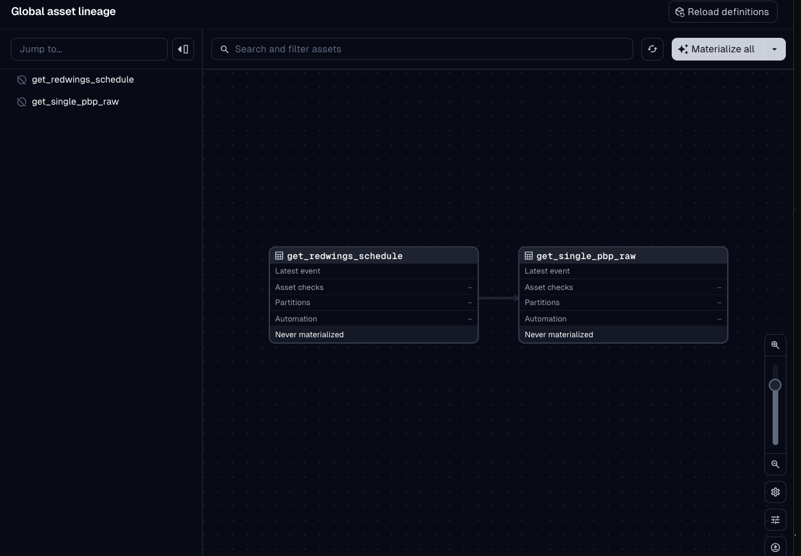

# NHL Pre-Scout

An opponent pre-scout tool for NHL coaches and GMs, built on the public NHL API. The pipeline pulls a team's season of play-by-play, boxscores, and shift charts, models it into team and player tendencies, and publishes a pre-scout report to a React front end with a Coach/GM toggle. Development is focused on the Detroit Red Wings, with team and season as config inputs so the same pipeline runs for any club.

## Tech stack

| Layer         | Choice                                                            |
| ------------- | ----------------------------------------------------------------- |
| Source        | NHL public API (play-by-play, boxscores, shift charts) + NHL EDGE |
| Ingestion     | Python (HTTP client), raw JSON cached to disk                     |
| Warehouse     | DuckDB                                                            |
| Transforms    | dbt (dbt-duckdb)                                                  |
| Orchestration | Dagster (runs ingestion assets and dbt models)                    |
| Front end     | React + TypeScript, reads the pre-scout JSON contract             |
| Design        | Figma                                                             |
| Hosting       | Render static site                                                |

## Project structure

```text
config/      team and season settings
data/        raw JSON, manifest, and DuckDB warehouse (gitignored)
pipeline/    Dagster assets: ingestion, metrics, reporting
analytics/   dbt project: sources and staging models
app/         React front end
tests/       Unit tests (mocked, no live API calls)
```

## Setup

Requires Python 3.13, Node, and pnpm.

```bash
git clone https://github.com/Granatire97/nhl_prescout.git
cd nhl_prescout
python3.13 -m venv .venv
source .venv/bin/activate
pip install -e .
```

Front end:

```bash
cd app
pnpm install
```

## Configuration

Set the team and season in `config/settings.yaml`:

```yaml
team: DET
season: 20262027
```

## How to run

Pipeline (opens the Dagster UI at http://localhost:3000):

```bash
dagster dev
```

### Materialize the ingestion assets

1. Run `dagster dev` from the project root and open http://localhost:3000.
2. Go to **Assets** → **View lineage**.
3. Click **Materialize all**.

This runs five assets in order:

| Asset              | Output                                                                                                     |
| ------------------ | ---------------------------------------------------------------------------------------------------------- |
| `raw_schedule`     | `data/raw/{season}/schedule_{team}.json`                                                                   |
| `raw_pbp`          | `data/raw/{season}/{gameId}/pbp.json` for every completed regular season game                              |
| `raw_boxscore`     | `data/raw/{season}/{gameId}/boxscore.json` for every completed regular season game                         |
| `raw_shifts`       | `data/raw/{season}/{gameId}/shifts.json` for every completed regular season game                           |
| `ingest_manifest`  | `ingest.manifest_latest` and `ingest.manifest_games` in `data/pre_scout_warehouse.duckdb`                  |
| `raw_tables`       | `raw.schedule`, `raw.pbp_plays`, `raw.boxscore_players`, `raw.shifts` in `data/pre_scout_warehouse.duckdb` |
| `stg_play_by_play` | `staging.stg_play_by_play` (dbt model, built by `dbt build`)                                               |

### Data quality flags

Each asset validates its files and records flagged game IDs in the run metadata. Flagged files are kept, not deleted.

| Flag                   | Asset          | Rule                                                                                          |
| ---------------------- | -------------- | --------------------------------------------------------------------------------------------- |
| `EMPTY_PLAYS`          | `raw_pbp`      | `plays` missing or empty                                                                      |
| `MISSING_PLAYER_STATS` | `raw_boxscore` | either team has no forwards in `playerByGameStats`                                            |
| `EMPTY_SHIFTS`         | `raw_shifts`   | no shift rows (`typeCode` 517)                                                                |
| `PARTIAL_SHIFTS`       | `raw_shifts`   | either team has fewer than 18 players with shifts                                             |
| `TRUNCATED_SHIFTS`     | `raw_shifts`   | shifts end before the game's last period, or a regulation game's last shift ends before 19:00 |

Shootouts count as period 5 but have no shifts, so shift data is expected to end at period 4. Validated on 2025-26 DET: 82 games, 0 flags. Recent games can return empty shift data until the NHL publishes it, so `EMPTY_SHIFTS` on a game from the last few days usually clears on a later run with `force: true`.

`raw_pbp`, `raw_boxscore`, and `raw_shifts` skip games already on disk, so re-runs only fetch new games. Files are keyed by season and game ID, so games shared between teams are fetched once. Each run logs attempted, downloaded, skipped, failed, and flagged counts as asset metadata.

### Ingestion manifest

Every cache run appends one row per game to `data/manifest/{endpoint}.jsonl` (pbp, boxscore, shifts), so run history is never overwritten. Each row has the run ID, run timestamp, season, game ID, endpoint, status (`DOWNLOADED`, `SKIPPED`, `FAILED`), file size, and quality flags. Skipped games are re-validated, so their flags stay current.

`ingest_manifest` runs after all three cache assets and builds two DuckDB tables:

| Table                    | Grain           | Purpose                                                                                         |
| ------------------------ | --------------- | ----------------------------------------------------------------------------------------------- |
| `ingest.manifest_latest` | game + endpoint | Latest status for each file                                                                     |
| `ingest.manifest_games`  | game            | `usable = 1` only when pbp, boxscore, and shifts are all present, none failed, and none flagged |

Each run logs a summary: total games, complete games, unusable games, and counts per flag.

Unusable games and why:

```sql
SELECT game_id, all_flags
FROM ingest.manifest_games
WHERE usable = 0
ORDER BY game_id;
```

### Raw layer

`raw_tables` runs after `ingest_manifest` and loads the cached JSON into four DuckDB tables in the `raw` schema. Only games with `usable = 1` in `ingest.manifest_games` are loaded by default.

| Table                  | Grain                                                                    |
| ---------------------- | ------------------------------------------------------------------------ |
| `raw.schedule`         | one row per game on the team's schedule                                  |
| `raw.pbp_plays`        | one row per play-by-play event                                           |
| `raw.boxscore_players` | one row per player per game, labeled by `team_side` and `position_group` |
| `raw.shifts`           | one row per shift chart row                                              |

Every row has `game_id` and `loaded_at`. Nested fields are kept as JSON (`details` on plays, `stats` on players), and clock values like `toi` and `timeInPeriod` stay as `mm:ss` text. Type casting happens in dbt staging.

Each load runs in one transaction. A reload deletes the incoming games' rows before inserting, so re-runs replace data instead of duplicating it. Schedule rows are replaced by season and team. If any usable game has no rows in `raw.pbp_plays`, the run fails and rolls back.

To load unusable games too, set this in the launchpad:

```yaml
ops:
  raw_tables:
    config:
      include_unusable: true
```

### dbt

The dbt project lives in `analytics/` and runs on dbt v2, which includes the DuckDB adapter. The profile is in the repo (`analytics/profiles.yml`) and points at `data/pre_scout_warehouse.duckdb`. Set `DUCKDB_PATH` to use a different file.

Sources are the four `raw` tables. Staging models flatten them into typed columns. No team codes are hardcoded: team is always a column, so any team can be filtered with a `WHERE`.

| Model                      | Grain                                                | Tests                                                                                                   |
| -------------------------- | ---------------------------------------------------- | ------------------------------------------------------------------------------------------------------- |
| `staging.stg_play_by_play` | one row per event (`event_key` = game ID + event ID) | `unique` and `not_null` on `event_key`, `not_null` on `game_id`, `home_team_abbrev`, `away_team_abbrev` |

Run dbt on its own:

```bash
cd analytics
dbt debug --profiles-dir .
dbt build --profiles-dir .
```

Run through Dagster: the dbt models show up as assets downstream of `raw_tables`. Materializing them runs `dbt build`, and each dbt test shows as an asset check.



To re-download everything, open **Materialize → Open launchpad** and set:

```yaml
ops:
  raw_pbp:
    config:
      force: true
```

The same `force` config works for `raw_boxscore` and `raw_shifts`.

### Front end

```bash
cd app
pnpm dev
```

## Run the tests

```bash
pip install -e ".[dev]"
pytest
```

## Project tracking

Work is tracked on the [Jira board](https://mgnhlprescout.atlassian.net/jira/software/projects/SCRUM/boards/1).
