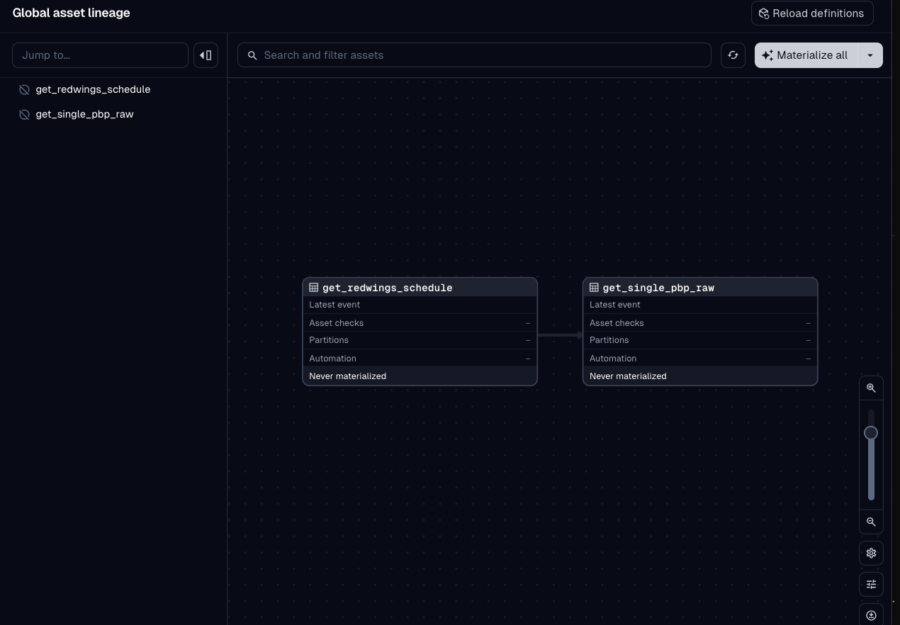

# NHL Pre-Scout

An opponent pre-scout tool for NHL coaches and GMs, built on the public NHL API. The pipeline pulls a team's season of play-by-play, boxscores, and shift charts, models it into team and player tendencies, and publishes a pre-scout report to a React front end with a Coach/GM toggle. Development is focused on the Detroit Red Wings, with team and season as config inputs so the same pipeline runs for any club.

## Tech stack

| Layer | Choice |
| --- | --- |
| Source | NHL public API (play-by-play, boxscores, shift charts) + NHL EDGE |
| Ingestion | Python (HTTP client), raw JSON cached to disk |
| Warehouse | DuckDB |
| Transforms | dbt (dbt-duckdb) |
| Orchestration | Dagster (runs ingestion assets and dbt models) |
| Front end | React + TypeScript, reads the pre-scout JSON contract |
| Design | Figma |
| Hosting | Render static site |

## Project structure

```text
config/      team and season settings
data/        raw JSON and DuckDB file (gitignored)
pipeline/    Dagster assets: ingestion, metrics, reporting
dbt/         dbt project: staging, intermediate, marts
app/         React front end
tests/       Unit tests (mocked, no live API calls)
```


## Setup

Requires Python 3.13, Node, and pnpm.

```bash
git clone https://github.com/Granatire97/nhl_prescout.git
cd nhl_prescout
python3.13 -m venv .venv
source .venv/bin/activate
pip install -e .
```

Front end:

```bash
cd app
pnpm install
```

## Configuration

Set the team and season in `config/settings.yaml`:

```yaml
team: DET
season: 20262027
```

## How to run

Pipeline (opens the Dagster UI at http://localhost:3000):

```bash
dagster dev
```

### Materialize the ingestion assets

1. Run `dagster dev` from the project root and open http://localhost:3000.
2. Go to **Assets** → **View lineage**.
3. Click **Materialize all**.

This runs two assets in order:

| Asset | Output |
| --- | --- |
| `get_raw_schedule` | `data/raw/{season}/schedule_{team}.json` |
| `raw_pbp_single_game` | `data/raw/{season}/{gameId}/pbp.json` |

Each run logs file size and path as metadata on the asset page.
The pbp asset now picks the first completed regular season game.



### Front end

```bash
cd app
pnpm dev
```

## Run the tests

```bash
pip install -e ".[dev]"
pytest
```

## Project tracking

Work is tracked on the [Jira board](https://mgnhlprescout.atlassian.net/jira/software/projects/SCRUM/boards/1).
